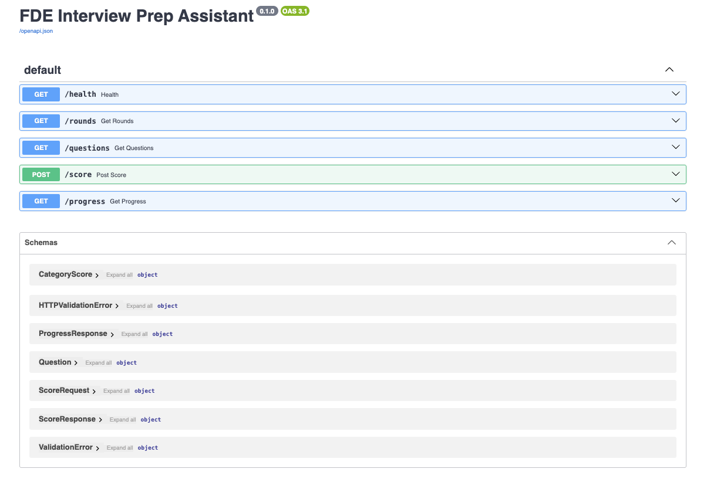
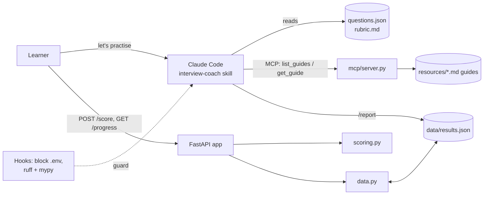
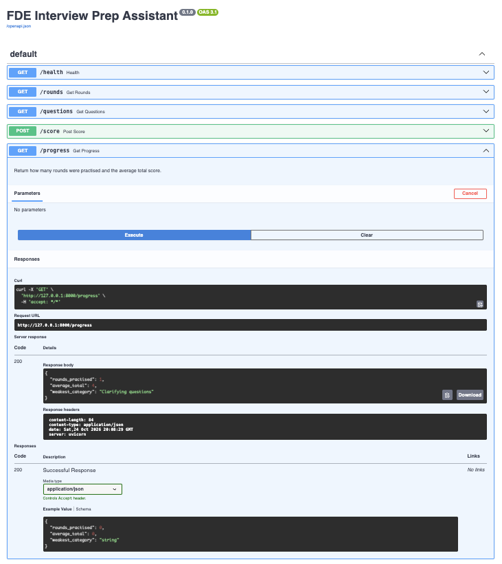

# 🧠 FDE Interview Coach

**Repo:** [github.com/pbhat123/My-FDE-Coach-v2](https://github.com/pbhat123/My-FDE-Coach-v2)

   

---

## 1️⃣ Project Title & Value Proposition

**An AI mock-interview coach for Forward Deployed Engineer (FDE) candidates. It runs realistic interview rounds, scores each answer against a fixed rubric, and tells you which skill is your weakest.**

The project has two layers:
- **The product** is a FastAPI service plus a Claude Code skill. Together they run mock rounds, score them out of 20, track progress over time, and identify your weakest rubric category.
- **The process** is the build itself. It was done end to end with a coding agent (Claude Code) under human direction: plan before coding, test-first, hooks as guardrails, MCP tools, and spec-driven delivery. That workflow is the skill the FDE "AI-assisted pair-coding" interview round assesses.



---

## 2️⃣ Background & Problem Context

FDE interviews test a mix of skills that are hard to practise alone:

- **Decomposition / case rounds:** you get a vague enterprise problem and must scope it.
- **Client role-play:** you handle an unhappy or unclear stakeholder.
- **Behavioral (STAR)** and **system design** rounds.
- Increasingly, an **AI-assisted pair-coding round**, where you're scored on how you direct, check and correct a coding agent.

**The pain:** candidates practise by reading guides or rehearsing answers in their head. That gives no feedback, and a different study partner judges differently each time. Most importantly, you can't tell *which dimension* is holding you back. An answer can be well structured and still never name the riskiest assumption.

**Why simple tools fall short:** a question bank tells you what to practise, not how well you did. A generic chatbot will happily "interview" you, but without a fixed rubric, a fixed procedure or saved history, the scores drift from session to session and can't be compared.

---

## 3️⃣ Target User & Job To Be Done (JTBD)

**Primary user:** an engineer preparing for Forward Deployed Engineer interviews, practising alone in the evenings.

**Secondary user:** a coach or bootcamp running mock rounds who needs consistent, comparable scoring.

**JTBD:** *"When I practise an FDE interview round, I want my answer scored consistently on the same rubric every time, so I can see whether I'm improving and know exactly which skill to work on next."*

---

## 4️⃣ Why an Agentic Approach

To be precise about where the agent is, and where it isn't:

| Part | Agentic? | Why |
|---|---|---|
| `POST /score`, `GET /progress` | ❌ Deterministic | Scoring arithmetic, saving results and computing the weakest category must be exact and testable. A script is the right tool here. |
| **interview-coach skill** | ✅ Agent | It has to choose and present a question, stay in role, answer clarifying questions as the interviewer, and judge free-text answers against the rubric. That needs reasoning, not rules. |
| **MCP guide server** | ✅ Agent tools | The agent decides when it needs study material and fetches only the relevant guide as a tool call. Nobody pastes guides into the prompt. |
| **The build** | ✅ Agent, with a human in the loop | Claude Code read the repo, proposed plans, wrote code and tests, and debugged. A human approved or redirected every step. |

**Why not a script or chatbot:** a script can't judge whether "First I'd ask who the stakeholders are…" counts as a strong clarifying question. A plain chatbot can, but it forgets the procedure, drifts on the rubric and can't read the question bank or your history. The skill fixes the procedure, the files fix the rubric, and the tools give the agent the data it needs. That combination is what makes the agent consistent.

---

## 5️⃣ Agent Role, Scope & Autonomy Level

**The coach agent owns, end to end:**
- choosing a question for the round you pick,
- running the round in the interviewer role,
- scoring 0–5 on each of the four rubric categories, giving a total out of 20 and one concrete improvement.

**Humans intervene:**
- **The learner** picks the round and decides when to start another.
- **During the build,** a human approved every diff. Plan Mode was used before any multi-file change.

**Restricted actions:**
- The coach is **read-only**. It never edits `data/` or writes results.
- Claude Code **can't read `.env`**; a hook blocks it.
- It must **ask before overwriting** `data/results.json` and **show the diff** before applying edits. These rules are in `CLAUDE.md`.

---

## 6️⃣ Agent Architecture & Components



**a) Planner / decision layer**
- **The coach** follows a static plan: a fixed procedure in `SKILL.md` (ask the round, present one question, take the answer, score, give one improvement). Claude loads it on its own when you say "practise" or "run a mock round."
- **The build** used dynamic planning. Plan Mode produced `plans/001-progress-endpoint-plan.md`, and spec-driven development broke a feature into seven tasks in `specs/001-category-scores/`.

**b) Executors / sub-agents**
| Executor | Responsibility |
|---|---|
| `app/main.py` (FastAPI) | Thin routes: `/health`, `/rounds`, `/questions`, `POST /score`, `GET /progress` |
| `app/scoring.py` | Scores answers, computes totals, maps totals to summary bands, finds the weakest category |
| `app/data.py` | All disk access (the JSON files) |
| `mcp/server.py` | FastMCP server exposing the study guides as two tools |
| `/report` slash command | Read-only progress summary from `results.json` |
| Subagent | Drafted `resources/negotiation-guide.md` in parallel with the main session |

**c) Memory**
- **Short-term:** the Claude Code session, which holds the current round, question and answer.
- **Long-term:** `data/results.json`, where every scored attempt is saved with its per-category scores. Plus **`CLAUDE.md`**, the project memory every new session loads, and the plan and spec files, which serve as decision records.

**d) Orchestration logic**
- The Claude Code agent loop: read, propose, wait for human approval, execute, check, repeat.
- **Hooks** run deterministically on every tool call. A `PreToolUse` hook blocks reading `.env`; a `PostToolUse` hook runs ruff and mypy after every edit.
- **Failure handling:** `/progress` returns zeros before any division when there are no results. Unknown category names are skipped rather than crashing. The MCP server raises a clear `ToolError` that lists the available guides. The check hook **skips** a missing tool instead of failing, so the agent never wastes turns trying to "fix" the hook.

---

## 7️⃣ End-to-End Agent Workflow

**A mock round (the agent path):**
1. **Input:** the learner types *"let's practise."*
2. **Context:** Claude matches the request to the `interview-coach` skill's description and loads it.
3. **Planning:** it asks which round: decomposition, client-roleplay, behavioral or system-design.
4. **Tool execution:** it reads `data/questions.json` and presents **one** question. It can fetch the matching study guide through the MCP server.
5. **Answer intake:** it stays in role and answers clarifying questions as the interviewer, without coaching.
6. **Validation:** it reads `data/rubric.md` at scoring time, the single source of truth, and scores four categories, each with a one-line justification quoting the answer.
7. **Output:** a score table, `Total: N/20` (which must equal the sum), and **one** improvement tied to the lowest category.

**A scored attempt (the API path):**
`POST /score` → `score_answer()` → `format_scorecard()` (total plus summary band) → `save_result()` saves `{round, question_id, total, max, categories}` → `GET /progress` returns `rounds_practised`, `average_total` (1 decimal) and `weakest_category`.

---

## 8️⃣ Tools, Models & Stack (With Rationale)

| Component | Choice | Why |
|---|---|---|
| Coding agent | **Claude Code** | Works inside the repo: reads files, runs tests, edits code, with approve-or-redirect on every step. |
| API | **FastAPI + Pydantic v2** | Typed request and response models, with free interactive docs at `/docs`, which serve as the UI. |
| Storage | **Plain JSON files** | No database to set up. All disk access sits in `data.py`, so swapping in a database later means changing one file. |
| Scoring | **Offline mock scorer** (OpenAI hook stubbed) | Free, deterministic and testable offline. The model ID is kept in one constant for the future LLM scorer. |
| Agent tools | **MCP via FastMCP** | An open standard: the guides become tools any MCP client can call. |
| Guardrails | **Claude Code hooks** (Python) | Enforcement, not suggestion. They run on every tool call, regardless of the prompt. |
| Quality gates | **pytest, ruff, mypy** | Behaviour, style and types, checked after every edit. |
| Delivery | **git + GitHub CLI** | One commit per task, shipped as a single reviewable pull request. |

---

## 9️⃣ Evaluation Strategy & Metrics

| Metric | Result |
|---|---|
| Test suite | **33 passing** (up from 3 at the start) |
| Acceptance criteria (spec 001) | **12/12 verified**, each backed by a named test or check |
| Test strength (mutation checks) | **3/3 mutations caught.** Breaking the old-record handling, the tie-break or the unknown-name guard each turned the matching tests red. |
| Lint and types | ruff and mypy clean, enforced by hook after every edit |
| Cost per scored answer | **$0** in mock mode; no API calls |
| Latency | Local, in-process scoring. Not benchmarked; there's no network hop in mock mode. |
| Human intervention rate (build) | **100% of diffs reviewed.** About 8 substantive corrections to the agent (see Learnings) |

**Known false positives / negatives:**
- The mock scorer rewards **length and line breaks, not content**, so a long, padded answer outscores a short, sharp one.
- In mock mode every category gets the **same score**, so `weakest_category` is always a tie and returns "Clarifying questions." That's the tie rule working, not real signal.
- `block_env.py` uses a substring match: it **over-blocks** `.envrc` (false positive) and **doesn't cover** `cat .env` through Bash (false negative).

---

## 🔟 Guardrails, Trust & Safety

- **Secrets:** a `PreToolUse` hook blocks the agent from reading `.env`, enforced with exit code 2. `.env` is gitignored, and commits use the GitHub noreply email address.
- **Code quality:** a `PostToolUse` hook runs ruff and mypy after every edit and reports failures back to the agent immediately.
- **Data safety:** tests redirect storage to a temporary folder and **never** touch the real `data/results.json`. This is acceptance criterion 11, verified with `git status`.
- **Path safety:** the MCP server only serves names on its known-guide list, which blocks inputs like `../.env`.
- **Human override:** the learner can always stop a round or ignore a score. Every build change went through a visible diff and approval.
- **Observability:** uvicorn logs every request. The server log was used to settle a real data discrepancy during testing (see Learnings).

---

## 1️⃣1️⃣ Failure Modes & Tradeoffs

**Known edge cases and limits:**
- `.mcp.json` uses **absolute local paths**, so the MCP server must be re-registered on another machine.
- The `PostToolUse` hook assumes a `.venv` in the project folder.
- **Category names must exactly match the rubric.** A future LLM scorer returning "Risk Identification" (capital I) would be silently left out of `weakest_category`, so it should validate names.
- The coach **doesn't save** its rounds, so chat practice doesn't appear in `/progress` or `/report`. Only `POST /score` saves results.
- `results.json` has **no locking** and grows forever: it's fine for one user, but not for concurrent use.
- There's no authentication, and it's single-user by design.

**Tradeoffs accepted deliberately:**
- **JSON over a database:** simplicity now, with migration limited to one file later.
- **Mock over a real LLM:** free and deterministic tests, but scores that are only a placeholder.
- **Ties go to the first category in rubric order:** a deterministic single answer, rather than returning a list of tied categories, which would change the field's type.
- **Old records are skipped, not migrated:** there's no backfill. They still count toward totals but not toward the weakest category.

---

## 1️⃣2️⃣ Results, Learnings & Insights

**What worked better than expected:**
- **Plan Mode found the real dependency.** Without being asked, the agent noticed that `/progress` would always report zeros until `/score` actually saved results, and that the seeded bug would distort every total.
- **Characterization tests before refactoring.** The agent pointed out that "keep the tests green" proved nothing, because no test covered `format_scorecard`, and pinned every summary-band boundary before changing it.
- **Mutation testing.** For test-only tasks that couldn't "fail first," the code was broken on purpose to prove the tests could catch it.
- **The check hook paid off on its first run** by catching a lint error that pytest couldn't see.

**What failed initially, and the corrections I made to the agent:**
- It rounded `average_total` to **2** decimals; the requirement was **1**.
- Its plan would have **fixed the seeded bug during the build step**, which would have skipped the test-driven debugging exercise.
- It proposed **deferring known lint errors** to a later task, and **committing a known crash** (a `KeyError` on unknown names) to fix "in T6." Both were pulled forward.
- The spec was missing a **quality-bar criterion**, a **tests-never-touch-real-data** rule and **handling of unknown category names**. All three were added before any code was written.
- The check hook ran `python3`, which could **silently skip** ruff and mypy outside the venv. It was pinned to `.venv/bin/python`.

**Surprising behaviour:**
- The course's own `/report` brief asked for the "weakest rubric category," but the app **never saved category scores**. The agent flagged this instead of inventing numbers, and it became the spec-driven capstone feature.
- An "extra" saved record during manual testing turned out to be **two `POST /score` requests in the server log**: a double-submit, not a bug. When the data and your memory disagree, check the logs.
- GitHub **rejected the first push** because the commits exposed a private email address. The history was rewritten to the noreply address before anything was published.

**Key learning:** the agent is fast and usually right. The value I added was **direction** (what to build), **context** (rules in `CLAUDE.md`, the spec) and **oversight** (reading every diff and catching drift from the requirements).

---

## 1️⃣3️⃣ Future Improvements & Iteration Plan

**v2:**
- A **real LLM scorer** with structured output, plus **validation of category names** against the rubric.
- Have the **coach skill save its rounds** through `POST /score`, so chat practice shows up in `/progress`.
- **GitHub Actions CI** running pytest, ruff and mypy on every PR, then **branch protection** that requires those checks.
- Extend the `.env` guard to the **Bash tool**, and make `.mcp.json` **portable** with relative paths.
- Add a **negotiation round** to `questions.json`; the guide already exists.

**To scale:**
- Move to **SQLite or Postgres** behind `data.py`; add **auth** and per-user history.
- Add **per-category trends over time**, which the current spec lists as out of scope.
- Build an **eval set** of reference answers with human scores to measure LLM scorer accuracy.

---

## 1️⃣4️⃣ Demo & Artifacts

**Interactive API docs** (`/docs`): five endpoints and their schemas.


**`GET /progress` after a scored attempt:** the round count, the average total and the weakest category.



**Run it locally**
```bash
git clone https://github.com/pbhat123/My-FDE-Coach-v2.git
cd My-FDE-Coach-v2
python3 -m venv .venv && source .venv/bin/activate   # Windows: .venv\Scripts\activate
pip install -r requirements.txt
uvicorn app.main:app --reload    # open http://127.0.0.1:8000/docs
pytest -q                        # 33 passed
```
No API key is needed; scoring runs offline. To practise with the coach agent, open the folder in **Claude Code** and type *"let's practise."* Type `/report` for a progress summary.

**Artifacts in this repo**
| Path | What it is |
|---|---|
| `CLAUDE.md` | Project memory and house rules for the agent |
| `plans/001-progress-endpoint-plan.md` | The Plan Mode output |
| `specs/001-category-scores/` | The spec (12 acceptance criteria) and the 7-task breakdown |
| `.claude/hooks/` | `block_env.py` and `checks.py` |
| `.claude/skills/interview-coach/SKILL.md` | The coach agent's procedure |
| `.claude/commands/report.md` | The `/report` slash command |
| `mcp/server.py` | The MCP guide server |
| [Pull request #1](https://github.com/pbhat123/My-FDE-Coach-v2/pull/1) | The full build as one reviewable diff |

```
app/          FastAPI app: routes, models, scoring, data access
data/         questions.json, rubric.md, results.json
resources/    study guides served over MCP
tests/        33 tests (basic, progress, scoring, score endpoint)
mcp/          FastMCP server
plans/ specs/ decision records
```

---

## 1️⃣5️⃣ Role-Based Signal

- **For PMs:** problem framing (a consistent rubric and a weakest-skill signal), explicit scope and out-of-scope, measurable acceptance criteria, honest limitations, and trust controls (guardrails, read-only agent, human approval).
- **For EMs:** clear separation of layers (thin routes, pure scoring logic, a single storage module), spec-to-tasks-to-commits delivery, hooks as automated policy, MCP for tool integration, and a scaling path (database behind `data.py`, CI, auth).
- **For SWEs:** test-first development, characterization tests before refactoring, mutation checks proving the tests work, edge cases handled (empty data, ties, legacy records, unknown names), type-checked and linted code, and a seeded bug found by a failing test before it was fixed.

---

<sub>Built on the starter from the Interview Kickstart FDE program ([uday-ik/fde-interview-coach](https://github.com/uday-ik/fde-interview-coach)), extended with a spec-driven category-scores feature.</sub>
